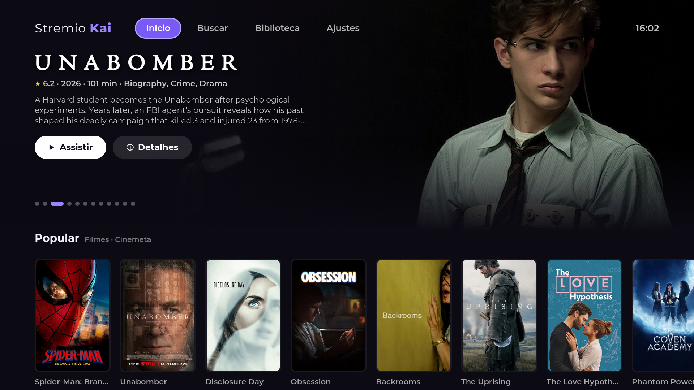

# Stremio Kai Timeworn

**Português** · [English](README.en.md)

O visual e as funções do [Stremio Kai](https://github.com/allecsc/Stremio-Kai) em **TVs LG antigas com webOS 3.x**, que não rodam o app oficial do Stremio.

Os plugins de IA do Kai (SVP, VapourSynth, Anime4K) ficam de fora porque a TV não aguenta. Todo o resto foi refeito para o navegador antigo da TV, o Chromium 38.

> Projeto **não oficial**, sem ligação com o Stremio, o Stremio Kai ou a LG. O app não hospeda nenhum conteúdo: ele só mostra o que os addons da **sua** conta Stremio entregam.

> [!IMPORTANT]
> **Para torrents, você precisa de um PC na mesma rede com o [stremio-service](https://github.com/Stremio/stremio-service/releases) aberto.**
> A TV não consegue rodar o motor de torrent do Stremio: ela tem só ~200 MB de espaço livre e ~180 MB de memória sobrando, e o sistema é antigo demais para o servidor do Stremio. O PC baixa e a TV assiste. Por isso o PC precisa ficar ligado enquanto você assiste.
> Links diretos (por exemplo, de um serviço de debrid na sua conta) tocam sem o PC.



## Funções

- **Sua conta Stremio:** login por código (no celular, em link.stremio.com) ou por e-mail. Addons, biblioteca e "Continuar assistindo" vêm da conta, e o progresso volta para ela.
- **Visual do Kai:**
  - Hero Banner rotativo, com fonte Cinemeta ou MDBList;
  - tema escuro ou OLED;
  - fonte Montserrat;
  - notas de várias fontes (IMDb, AniList; Rotten Tomatoes e Metacritic com chave MDBList);
  - sinopses no idioma do app e elenco com fotos (com chave TMDB).
- **Lista de fontes como no Kai do PC:**
  - links diretos (debrid) primeiro, depois os demais addons;
  - filtro por addon;
  - contador de addons carregando;
  - etiquetas 4K, HDR, Dolby Vision, REMUX e estimativa de Mbps.
- **Player:**
  - usa o player da própria TV, com decodificação por hardware de H.264, HEVC e HDR10;
  - pula abertura e encerramento (IntroDB e AniSkip);
  - legenda automática em PT-BR, no estilo do Kai (Nata Sans), configurável;
  - troca de áudio;
  - relógio com "termina às";
  - próximo episódio na mesma fonte;
  - reconexão automática se o vídeo travar.
- **Perfis:** tela "Quem está assistindo?", com cada perfil na própria conta Stremio (histórico, biblioteca e preferências separados).
- **Português e inglês:** segue o idioma da TV ou é escolhido em Ajustes → Idioma / Language.
- **Calendário de animes** da semana (AniList).
- **Feito para a TV:** navegação pelo controle e pelo ponteiro do Magic Remote, e cuidado com a pouca memória (imagens pequenas, carregamento sob demanda).
- **Atualização pelo próprio app:** Ajustes → Procurar atualização. Em TVs com Homebrew Channel, instala sozinho.

## Compatibilidade

| | |
|---|---|
| Testado | LG 43UJ6565 (2017), webOS 3.5, firmware 06.10.55 |
| Deve funcionar | outras LG com webOS 3.x ou mais novo (não testado) |
| Vídeo | MP4/MKV com H.264 ou HEVC. HDR10 sim; Dolby Vision só se a TV suportar |
| Rede | Prefira cabo. No Wi-Fi da UJ6565 medimos ~30 Mbps: 4K REMUX não flui, 4K WEB-DL e 1080p sim |

## Como os vídeos chegam na TV

| Tipo de fonte | Precisa do PC? | Como funciona |
|---|---|---|
| **Torrent** | **Sim** | O [stremio-service](https://github.com/Stremio/stremio-service/releases) roda num PC da mesma rede, baixa o vídeo e entrega para a TV. Na TV, use **Ajustes → Servidor → Procurar na rede**. O PC precisa ficar ligado. |
| **Link direto** (debrid ou HTTP) | Não | Se a sua conta usa um serviço de debrid (download em nuvem), os addons entregam links HTTP diretos, que a TV toca sozinha. |

**Por que a TV não roda torrent sozinha?** A TV tem ~200 MB de armazenamento livre e ~180 MB de memória sobrando. Um torrent precisa guardar pedaços do vídeo, e o motor do Stremio precisa de um Node.js moderno que o webOS 3.x não tem. No PC isso é trivial; na TV, impossível.

## Instalação na TV

Você vai precisar de um PC na mesma rede da TV e do arquivo `.ipk` da [última release](https://github.com/creachec/Stremio-Kai-Timeworn/releases/latest).

Escolha **um** dos caminhos:

### Opção 1: Modo Desenvolvedor da LG (sem root)

É o caminho oficial da LG e funciona em qualquer TV. Tem um porém: **a sessão de desenvolvedor expira a cada 50 horas**, e os apps instalados por ela somem se você não renovar.

1. No PC, crie uma conta gratuita em [webostv.developer.lge.com](https://webostv.developer.lge.com/) e confirme o e-mail.
2. Na TV, abra a **LG Content Store**, procure e instale o app **Developer Mode**.
3. Abra o Developer Mode e entre com a conta do passo 1.
4. Ligue **Dev Mode Status**. A TV reinicia.
5. Abra o Developer Mode de novo e ligue **Key Server**. Anote o **IP** e a **Passphrase** que aparecem na tela.
6. No PC, instale o [webOS Dev Manager](https://github.com/webosbrew/dev-manager-desktop/releases).
7. No Dev Manager, adicione a TV: modo *Developer Mode*, com o IP e a passphrase do passo 5.
8. Em **Apps**, clique em instalar e escolha o arquivo `com.kai.stremio_X.Y.Z_all.ipk` que você baixou.
9. O app **Stremio Kai Timeworn** aparece na lista de apps da TV.

**Para não perder o app:** abra o Developer Mode na TV de vez em quando e aperte **Extend** para renovar as 50 horas. O Dev Manager também consegue renovar pelo PC.

### Opção 2: TV com root (webOS Homebrew Channel)

Esse caminho é permanente: nada expira, e o app se atualiza sozinho pelos Ajustes.

1. Veja se o firmware da sua TV tem root em [cani.rootmy.tv](https://cani.rootmy.tv/) e siga o método indicado lá (RootMyTV, DejaVuln, faultmanager…). **Faça por sua conta e risco.**
2. Com o root feito, o app **Homebrew Channel** aparece na TV ([projeto](https://github.com/webosbrew/webos-homebrew-channel)).
3. No PC, use o [webOS Dev Manager](https://github.com/webosbrew/dev-manager-desktop/releases) e adicione a TV. No Homebrew Channel → Settings, ligue **SSH Server** e reinicie a TV (a senha padrão do root é `alpine`; troque-a ou use chave SSH).
4. Instale o `.ipk` pelo Dev Manager, como no passo 8 da opção 1.

As próximas versões são instaladas pela própria TV, em **Ajustes → Procurar atualização**.

### Primeiro uso

1. Abra o app. Um assistente pede o nome do perfil, a entrada na conta Stremio (mais fácil pelo código no celular) e procura o servidor do PC. Também pergunta o idioma da legenda.
2. No PC, deixe o **stremio-service** aberto sempre que for assistir torrents.
3. Em **Ajustes**, ajuste a fonte e o tamanho da legenda, o Hero Banner e o tema OLED. Pelo próprio app você pode instalar o **Anime Kitsu** e o **OpenSubtitles**, além de colar chaves TMDB e MDBList (opcionais, gratuitas).

## Privacidade e segurança

- A conta, as chaves e as preferências ficam **só na TV** (armazenamento local do app). O app conversa apenas com o Stremio, com os addons que você instalou e com APIs públicas de metadados (Cinemeta, TMDB/MDBList se você configurar, AniList, IntroDB, AniSkip).
- Dados vindos de addons nunca viram código. O app tem uma Content Security Policy que só deixa rodar o próprio código.
- O log remoto (para desenvolvimento) vem **desligado** e só envia para um endereço que você digitar. Chaves de debrid e de API são escondidas nos logs.
- A atualização pelo Homebrew Channel confere o **SHA-256** do arquivo antes de instalar.

## Desenvolvimento

Requisitos: Node.js 20 ou mais novo.

```bash
npm install
npm run build      # gera dist/ (JavaScript ES5 para o Chromium 38)
npm run serve      # testa no navegador do PC em http://localhost:5173 (1920x1080)
npm run release    # gera release/: .ipk + manifesto com SHA-256
npm run ship -- 1.0.1   # publica a versão no GitHub (precisa do gh autenticado)
```

Para instalar direto numa TV com root via SSH (chave em `~/.ssh/webos_tv`):

```bash
TV_IP=192.168.x.y KAI_DEVLOG=http://IP-DO-PC:8099/log npm run deploy
```

Com `npm run logs` aberto no PC, você vê o log da TV ao vivo.

Estrutura do código:
- `src/js/lib/`: navegação pelo controle, rede, Luna, imagens, legendas.
- `src/js/api/`: conta Stremio, protocolo de addons, servidor de streaming, notas, pular abertura, atualização.
- `src/js/views/`: as telas.
- `src/static/`: HTML, CSS (tema Kai) e ícones.
- `tools/`: build, deploy, release, log remoto, proxy de diagnóstico.

## Créditos

- [Stremio Kai](https://github.com/allecsc/Stremio-Kai), de allecsc: visual, ideias e o padrão das legendas.
- [Stremio](https://github.com/Stremio): a API da conta, o protocolo de addons, o stremio-service e o `stremio-video` (referência do player webOS).
- [webOS Homebrew](https://www.webosbrew.org/): Homebrew Channel, Dev Manager e documentação.
- Dados: [IntroDB](https://introdb.app), [AniSkip](https://aniskip.com), [AniList](https://anilist.co), [arm-server](https://arm.haglund.dev), Cinemeta, TMDB e MDBList.
- Fontes [Montserrat](https://fonts.google.com/specimen/Montserrat) e [Nata Sans](https://fonts.google.com/specimen/Nata+Sans) (SIL Open Font License).

## Licença

[GPL-3.0](LICENSE), a mesma do Stremio Kai.
