# Stremio Kai for Tizen

Stremio for Samsung Tizen TVs, including older models (2017 and newer, Tizen 3.0+) that can't
run the official Stremio app. It runs as a [TizenBrew](https://github.com/reisxd/TizenBrew)
app module and brings the [Stremio Kai](https://github.com/allecsc/Stremio-Kai) look and
features to Tizen, fully controlled with the Samsung remote.

> **Unofficial.** Not affiliated with Stremio, Stremio Kai or Samsung. The app hosts no
> content: it only shows what the add-ons on **your** Stremio account provide.

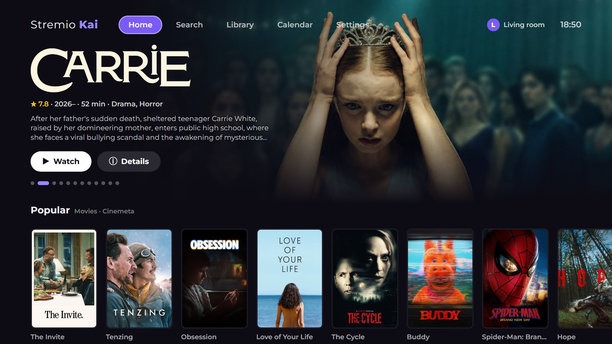

## Features

### A home screen built for the TV
Rotating hero banner with the title's logo, rating, runtime and genres, and **Watch** /
**Details** one press away. Below it, every catalog from your Stremio add-ons as a row.

### See all, without dead ends
Every row ends in a **See all** tile that opens the whole catalog as a grid. More titles load
on their own as you scroll down, so you never hit the end of a list.

| Row end | Full catalog |
|---|---|
| 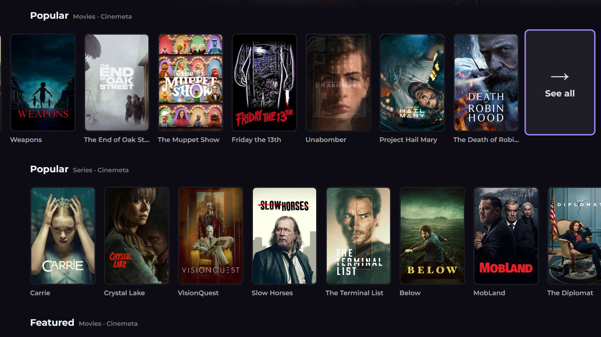 | 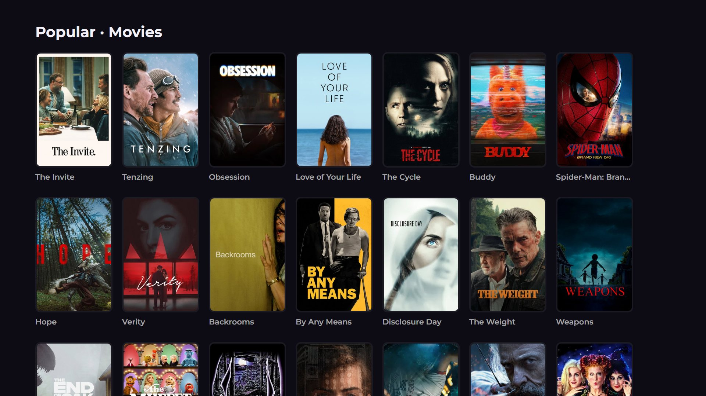 |

### Smart Choice
Press **Watch** and the app picks the best source and starts playing, no source list to scroll
through. It prefers direct (debrid) links, your add-ons' order, and files the TV plays well,
skipping Dolby Vision, REMUX and very high bitrates when there's anything else. If a source won't
start, it moves on to the next best one. **Sources** still shows the full list.

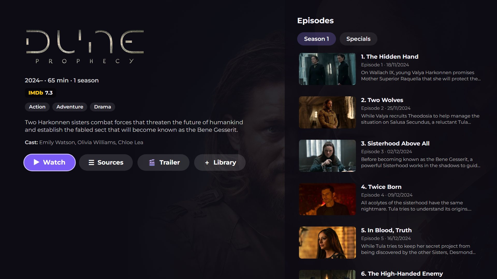

### Phone remote
Use your phone as the remote, no app to install. Scan the QR code in **Settings → Phone remote**
and your phone's browser opens a remote with a D-pad, OK, Back and playback buttons, plus a text
box that types straight into the TV's search or sign-in fields. A PIN shown on the TV keeps
others on your Wi-Fi out. It runs as a small TizenBrew service on the TV, nothing leaves your
home network.

| On your phone | On the TV (Settings) |
|---|---|
| 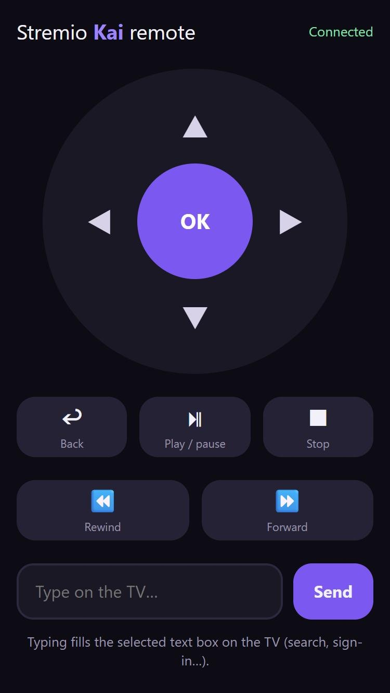 |  |

### Search across all your add-ons
Results from every add-on that supports search, grouped by movies and series.

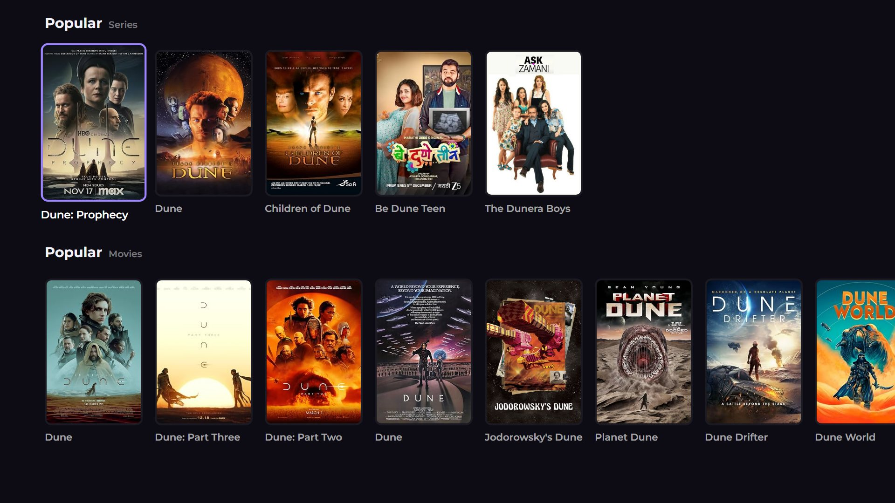

### Release calendar: anime, series and movies
A week at a time, day by day:
- **Anime:** every episode airing that day, including Chinese and Korean titles, with air
  time, episode and score.
- **Series:** new episodes from streaming services worldwide and US TV, with the network.
- **Movies:** the day each film becomes available to stream at home (with a free
  [TMDB](https://www.themoviedb.org/settings/api) key in Settings).

| Anime | Series |
|---|---|
| 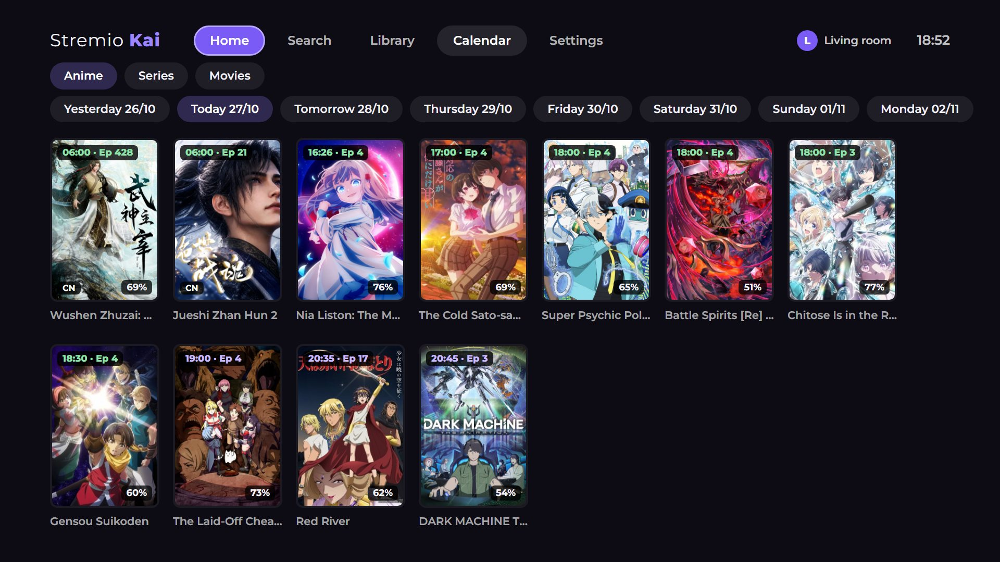 | 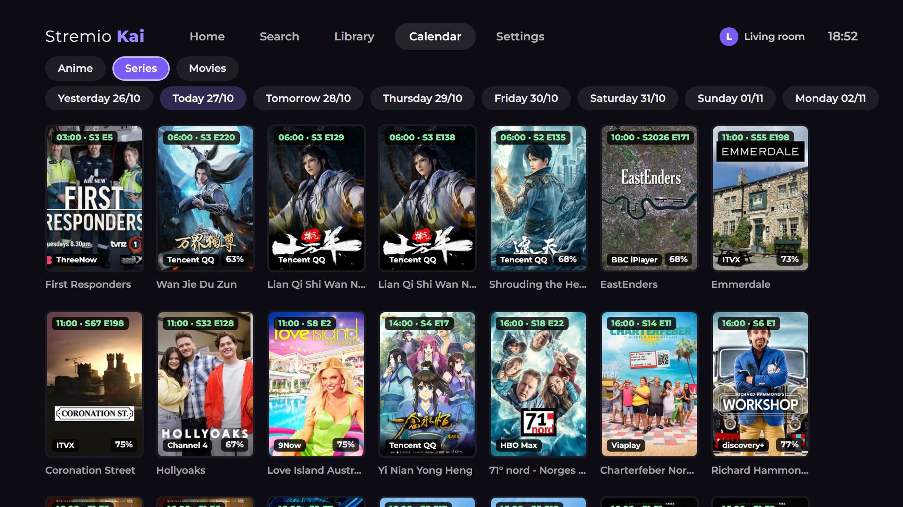 |

### English and Arabic
The whole app in **English** or **Arabic** (Settings → Language / اللغة, or automatic from the
TV's language). Arabic switches to a right-to-left layout, while titles and synopses keep their
own direction.

| Home | Details |
|---|---|
| 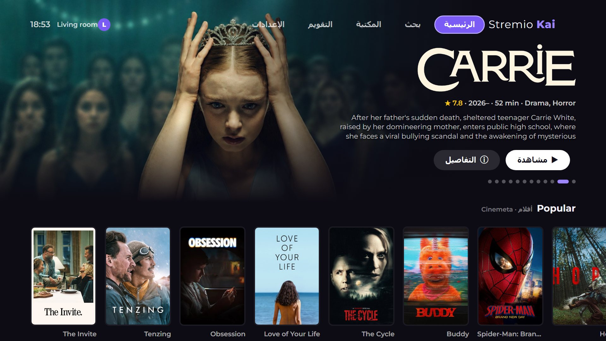 | 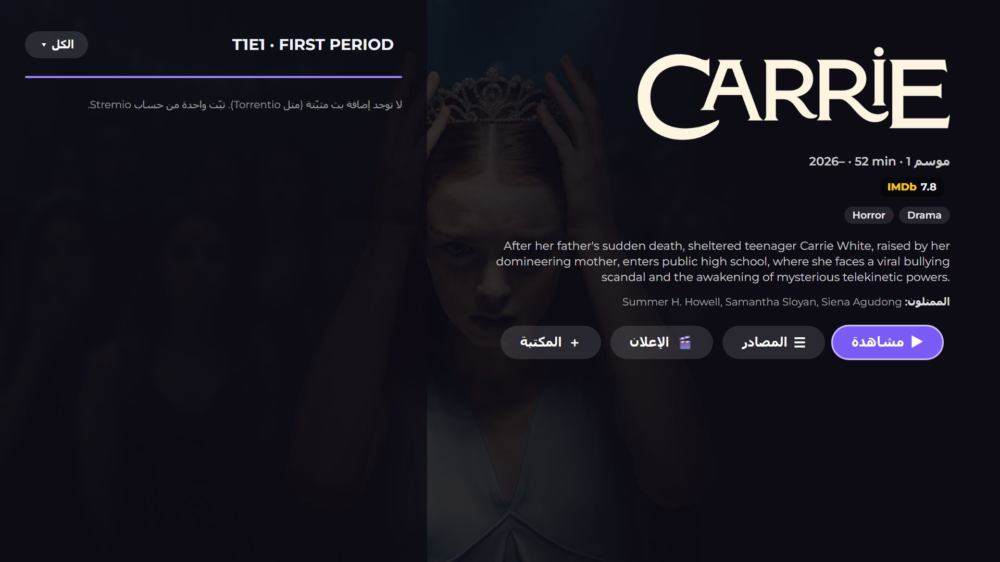 |

### Profiles and settings
"Who's watching?" profiles, each on its own Stremio account, plus language, Smart Choice,
theme, subtitle and streaming-server settings, all usable with the remote.

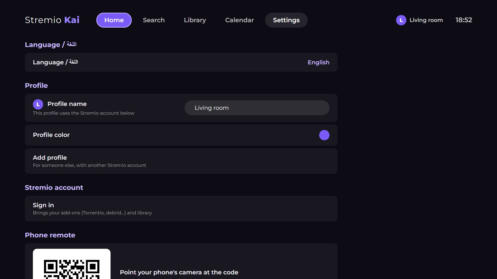

### Trailers and actor profiles
- **Trailer** on every film and series page plays the official trailer full screen. Back closes
  it, OK pauses, and left/right switch between trailers when there are several.
- Select anyone in the **cast** to open their profile: photo, age, birthplace, biography, and all
  their films and series, each one a press away.
- With a free [TMDB](https://www.themoviedb.org/settings/api) key in Settings, descriptions,
  titles and biographies appear **in Arabic** when the app is in Arabic (English when TMDB has
  no Arabic text).


### And more
- **In-app updater.** Settings shows the installed and newest version; one press updates.
- **Your Stremio account.** Sign in with a code (on your phone at link.stremio.com) or by email.
  Add-ons, library and "Continue watching" come from your account, and progress syncs back.
- **Ratings.** IMDb out of the box; Rotten Tomatoes, Metacritic, Letterboxd and Trakt with a
  free [MDBList](https://mdblist.com) API key (Settings).
- **Smart source list.** Direct (debrid) links first, filter by add-on, and 4K, HDR,
  Dolby Vision and REMUX tags.
- **Player.** Uses the TV's hardware player (H.264, HEVC, HDR10), skips intros and outros
  (IntroDB and AniSkip), automatic subtitles, next episode on the same source, and reconnects
  if a video stalls.
- **Built for the Samsung remote.** Arrows, OK, Return, play/pause, fast-forward/rewind,
  colour and channel keys, and Samsung's on-screen keyboard. No pointer needed.
- **Light enough for old Tizen.** Plain JavaScript compiled down for the old web engine on
  Tizen 3.0 (Chromium 47); no WebAssembly required.

## Requirements

- A Samsung TV running **Tizen 3.0 or newer** (2017 onwards). Tested on a 2017 UA65MU8500 (Tizen 3.0).
- **TizenBrew** on the TV (installation steps below).
- For playback, **one** of:
  - a **debrid** service (Real-Debrid, AllDebrid, etc.) in your Stremio add-ons: plays directly
    on the TV, no PC needed;
  - [stremio-service](https://github.com/Stremio/stremio-service/releases) running on a PC on
    the same network, for torrent streams. Tizen TVs can't run the torrent engine themselves.

## Installing on a Samsung TV

You need a PC on the same Wi-Fi as the TV for steps 1 to 3. After that, the TV works on its own.

### 1. Turn on Developer Mode

1. Find your PC's IP address (on Windows: open Command Prompt and run `ipconfig`; look for
   **IPv4 Address**, e.g. `192.168.1.20`). The TV and PC must be on the same network.
2. On the TV, press **Home** and open **Apps**.
3. On the Apps screen, type **1 2 3 4 5** with the remote's number keys (or the on-screen
   keypad on remotes without numbers).
4. In the **Developer Mode** window, switch **Developer mode** to **On**, enter your PC's IP
   address under **Host PC IP**, and select **OK**.
5. **Restart the TV**: hold the remote's power button until the TV turns off and back on,
   or unplug it for 30 seconds. Developer Mode only starts after a full restart.

### 2. Download TizenBrew Installer

TizenBrew Installer is a small desktop app that puts TizenBrew on the TV.

1. On the PC, open the
   [TizenBrew Installer releases page](https://github.com/reisxd/TizenBrewInstaller/releases/latest).
2. Under **Assets**, download the file for your computer:

   | Computer | File |
   |---|---|
   | Windows | `TizenBrewInstaller-win-x64.exe` |
   | Mac (Apple Silicon, M1 or newer) | `TizenBrewInstaller-macos-arm64` |
   | Mac (Intel) | `TizenBrewInstaller-macos-x64` |
   | Linux | `TizenBrewInstaller-linux-x64` |

   Ignore `TizenBrewInstaller.wgt`, which is the TV version.
3. Run it:
   - **Windows:** double-click the `.exe`. If Windows SmartScreen says it "protected your PC",
     click **More info → Run anyway** (the installer isn't signed by Microsoft). If the firewall
     asks, allow it on **Private networks**.
   - **Mac / Linux:** open Terminal in the download folder, run
     `chmod +x TizenBrewInstaller-*`, then run the file (e.g. `./TizenBrewInstaller-macos-arm64`).
     On a Mac, if it's blocked, allow it in **System Settings → Privacy & Security**.

### 3. Install TizenBrew with the installer

1. Find the **TV's IP address**: on the TV, go to **Settings → General → Network →
   Network Status → IP Settings** and note the **IP Address** (e.g. `192.168.1.35`).
2. In TizenBrew Installer, type the TV's IP into the **TV IP** box and click **Connect to TV**.
   - *"Could not connect to the SDB Daemon"* means the TV is off, the IP is wrong, or the TV
     wasn't restarted after step 1.
3. Click **Install TizenBrew**. It shows *Fetching package → Installing package →
   Package installed*.
   - **Tizen 7 or newer (2023+ TVs):** it shows **Resigning required**. Click
     **Sign in to Samsung Account**, sign in, and follow its steps so it can sign TizenBrew
     for your TV. Older TVs skip this.
4. **TizenBrew** now appears in the TV's **Apps**. You can close the installer.

See the [TizenBrew install guide](https://github.com/reisxd/TizenBrew/blob/main/docs/README.md)
for other install methods.

### 4. Point Developer Mode at the TV itself

TizenBrew needs this to run:

1. On the TV, open **Apps** and type **1 2 3 4 5** again.
2. Keep **Developer mode** **On**, change **Host PC IP** to **127.0.0.1**, and select **OK**.
3. Restart the TV again.

Leave Developer Mode on from now on, or TizenBrew won't open.

### 5. Add Stremio Kai

1. Open **TizenBrew** and go to **Module Manager → Add module**.
2. Choose **GitHub** (not NPM) and enter:
   ```
   ITzAkai/stremio-kai-tizen
   ```
3. **Stremio Kai** now appears in TizenBrew. Open it.

### 6. First launch

1. The setup asks for a **torrent server**. If you use debrid, choose **Skip**. For torrents,
   start [stremio-service](https://github.com/Stremio/stremio-service/releases) on a PC on the
   same network and choose **Scan network**.
2. Sign in to your Stremio account: go to **link.stremio.com** on your phone and enter the code
   shown on the TV, or sign in with email.
3. Your add-ons and library load from your account. Pick something and play.

**Updating:** open **Settings → Updates**. It shows your installed version and the newest one on
GitHub with what changed; **Check for update → Update now** installs it and reloads the app. The
app also checks once a day and tells you when there's something new.

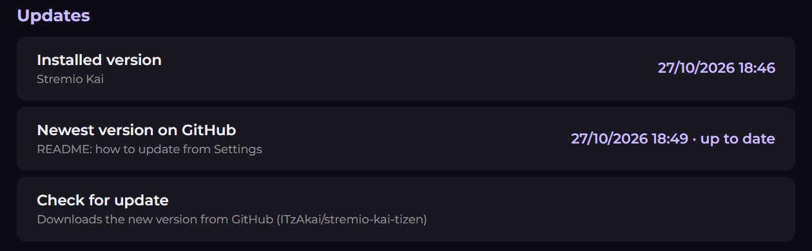

### Troubleshooting

- **TizenBrew won't open:** check that Developer Mode is still **On** with Host PC IP
  **127.0.0.1**. A TV firmware update or factory reset turns it off.
- **The installer can't find the TV:** make sure the Host PC IP in step 1 is the PC's current IP,
  the TV was restarted afterwards, and both are on the same network (not a guest network).
- **A video won't play:** try a debrid (direct) source, or check that stremio-service is
  running on the PC for torrent sources.

## Tizen integration

- Samsung **Return**, media, colour and channel keys, registered through the Tizen
  TVInputDevice API.
- Exits through the Tizen application API.
- Finds the TV's IP address (to scan the network for stremio-service) through Samsung's
  network API, with a WebRTC fallback.
- Shows the TV model in Settings through Samsung's product info API.
- Updates through TizenBrew.

## Known limitations

- **Audio and subtitle track switching** inside a video doesn't use Samsung's player API yet,
  so it may not work on every TV. Please open an issue if it doesn't on yours.
- The AI enhancements of the PC version of Stremio Kai (SVP, VapourSynth, Anime4K) are not
  included: TVs can't run them.

## Building

Needs Node.js.

```
npm install
npm run build
```

The built app is written to `dist/`, which TizenBrew loads (`appPath` in `package.json`).

## Credits

- [Stremio Kai](https://github.com/allecsc/Stremio-Kai) by allecsc: the original design and features.
- [Stremio Kai Timeworn](https://github.com/creachec/Stremio-Kai-Timeworn) by binhoc: the
  lightweight TV build this Tizen version is based on.
- [TizenBrew](https://github.com/reisxd/TizenBrew) by reisxd: runs this app on Samsung TVs.
- [Stremio](https://www.stremio.com/).

## License

[GPL-3.0](LICENSE), the same as the projects it is based on.
